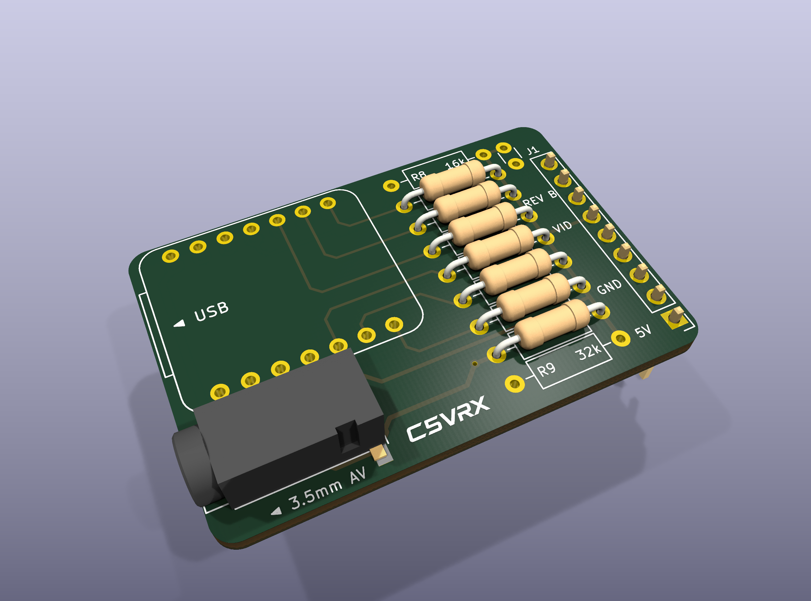
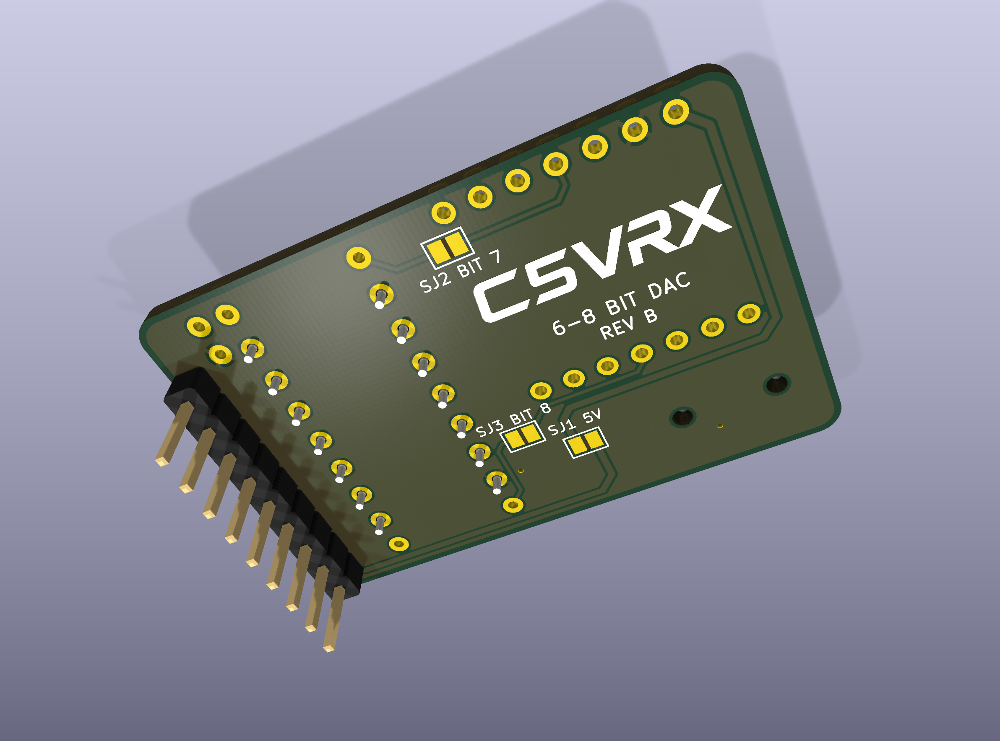

# C5VRX_JACK_DIY_V2 — REV B

A two-layer DIY carrier for the Seeed Studio XIAO ESP32-C5, with a Fat Shark module-bay header and PJ-320D 3.5 mm AV jack. REV B preserves the REV A outline (42.51 × 28.80 mm) and the XIAO, jack and bay-header positions, and adds reserved seventh/eighth DAC branches with separate rear solder jumpers.

  
  

## DAC branches and rear jumpers

| Jumper | Function | Default |
| --- | --- | --- |
| SJ1 / 5V | Connect Fat Shark bay 5 V to XIAO 5 V | Open; bridge for bay power |
| SJ2 / BIT 7 | Connect D10 / GPIO10 through R8 (16 kΩ) to VIDEO | Open |
| SJ3 / BIT 8 | Connect D3 / GPIO7 through R9 (32 kΩ) to VIDEO | Open |

R8 and R9 are **DNP** with the current six-bit firmware. The jumpers only connect hardware branches; they do not select a firmware mode. These are new **low bits**: in a future seven-bit implementation D10 is bit 0; in an eight-bit implementation D10 is bit 1, D3 is bit 0, and the existing D4–D9 outputs are bits 2–7.

| Output configuration | SJ2 | SJ3 | Additional resistors |
| --- | --- | --- | --- |
| Current six-bit | Open | Open | R8/R9 DNP |
| Future seven-bit | Closed | Open | Fit R8 |
| Future eight-bit | Closed | Closed | Fit R8 and R9 |

Wider output requires matching firmware and loaded CVBS level/linearity measurements; it is not enabled or hardware-qualified by this PCB. D3/GPIO7 is a boot-strapping pin: validate repeated cold boots and reset loading before fitting/enabling R9. PR [#259](https://github.com/Twotoz/C5VRX/pull/259) documents the reserved pins and internal GPIO27/GPIO2 IQ remap; no external IQ wiring is added. Keep the extra resistors unpopulated and jumpers open with current firmware.

R1–R7 retain the existing 8.2 kΩ / 3.9 kΩ / 2 kΩ / 1 kΩ / 470 Ω / 240 Ω branches and 200 Ω shunt. All resistors use DIN0207 axial through-hole footprints, 10.16 mm lead pitch; 1% is recommended. C1 is optional 470 pF / DNP. No additional 75 Ω shunt is fitted.

Open SJ1 before USB programming, as for REV A. J2 tip and ring 1 carry VIDEO, sleeve is GND, and ring 2 is unconnected.

## Layout and files

The resistor bank has 3.0 mm row spacing. The upper C1 hole aligns with the right R8 hole. C5VRX logos appear on both sides; the front logo uses the latest manually adjusted lower position. The back includes REV B, 6–8 BIT DAC, and individual jumper labels. The explicit jack-to-ground connection is retained: removing it and refilling the current zones leaves a disconnected ground island.

- Open `C5VRX_JACK_DIY_V2.kicad_pro` in **KiCad 10**. Project symbol/footprint libraries and the PJ-320D STEP model are included.
- [Fabrication ZIP](exports/C5VRX_JACK_DIY_V2-gerbers.zip): Gerber X2 plus plated/non-plated Excellon drills; [individual outputs](exports/gerbers/).
- [BOM](BOM.csv): actual PCB values, DNP flags and open rear solder bridges (PCB features, not purchased components).
- [Schematic PDF](exports/C5VRX_JACK_DIY_V2-schematic.pdf), [1:1 fit-check PDF](exports/C5VRX_JACK_DIY_V2-fit-check-1to1.pdf), top/bottom SVGs, STEP and GLB models are in `exports/`.
- [2400 × 1800 renders](exports/renders/) and [render ZIP](exports/C5VRX_JACK_DIY_V2-renders.zip). The XIAO mounting outline is visible because no module 3D model is supplied; DNP parts are omitted.
- [DRC report](validation/drc.json) and [ERC report](validation/erc.json): zero violations, zero unrouted connections and zero schematic/PCB parity issues on the saved board used for these exports.

Digital checks are not physical qualification. REV B has not yet been built or measured. REV A remains available in [C5VRX_JACK_DIY](../C5VRX_JACK_DIY/).

## Source and attribution

This carrier adapts the existing `hardware/C5VRX_JACK_DIY` board and DAC design from **C5VRX by Twotoz and the C5VRX contributors**, at repository base `fa5b1de`, with reserved expansion-pin details from PR #259. REV B adds the extra branches/jumpers, revises the layout and artwork, and includes regenerated fabrication and visualization files from the latest locally edited PCB.

Canonical source: [Twotoz/C5VRX](https://github.com/Twotoz/C5VRX). Visit the [official C5VRX website](https://twotoz.github.io/C5VRX/) for the project and its Discord invite. Applicable source terms are in [LICENSE](../../LICENSE); separate name/logo terms remain in [BRANDING.md](../../assets/BRANDING.md). This proposed hardware revision is not a claim of an already released or physically validated product.
