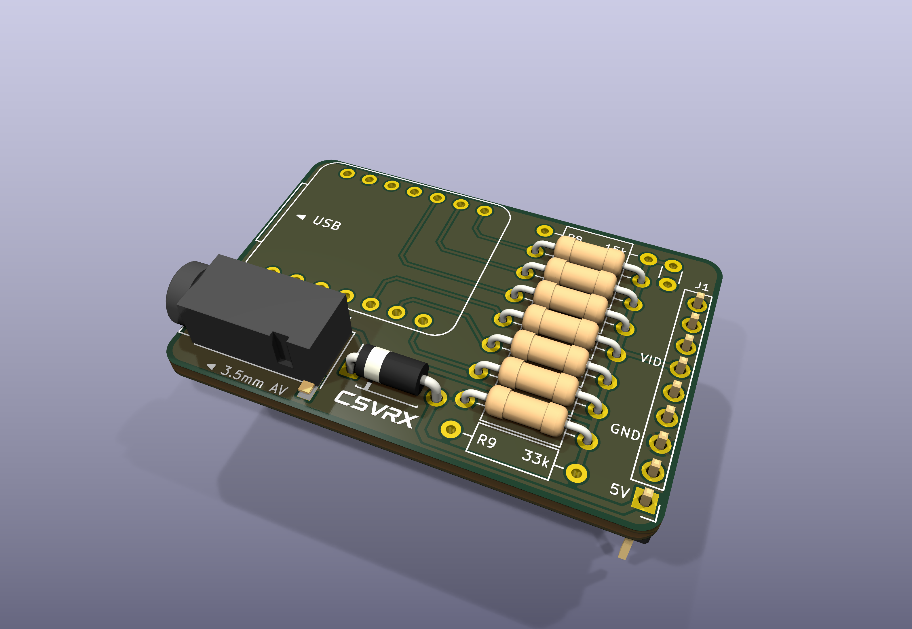
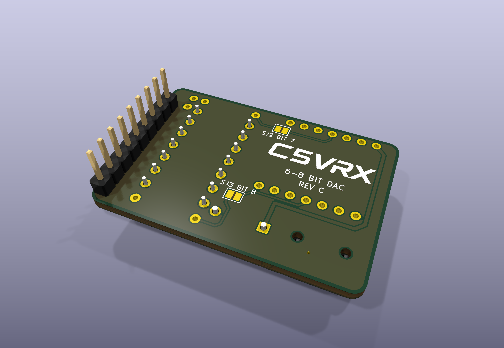
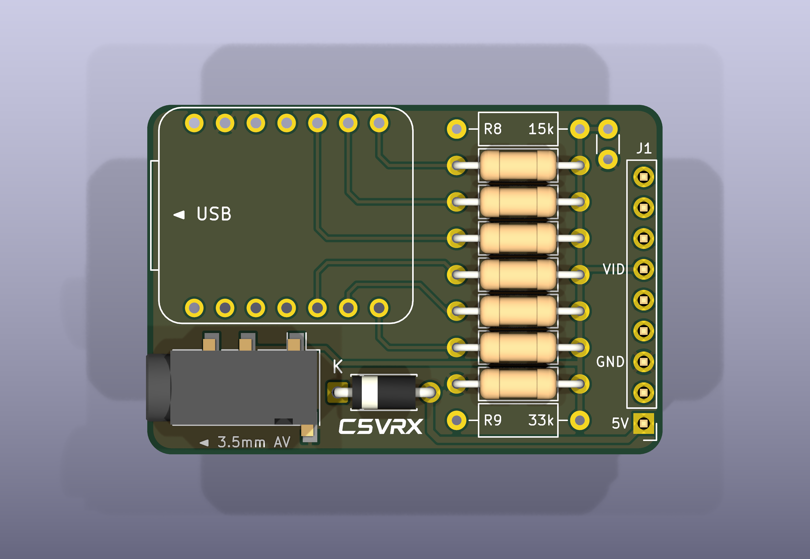
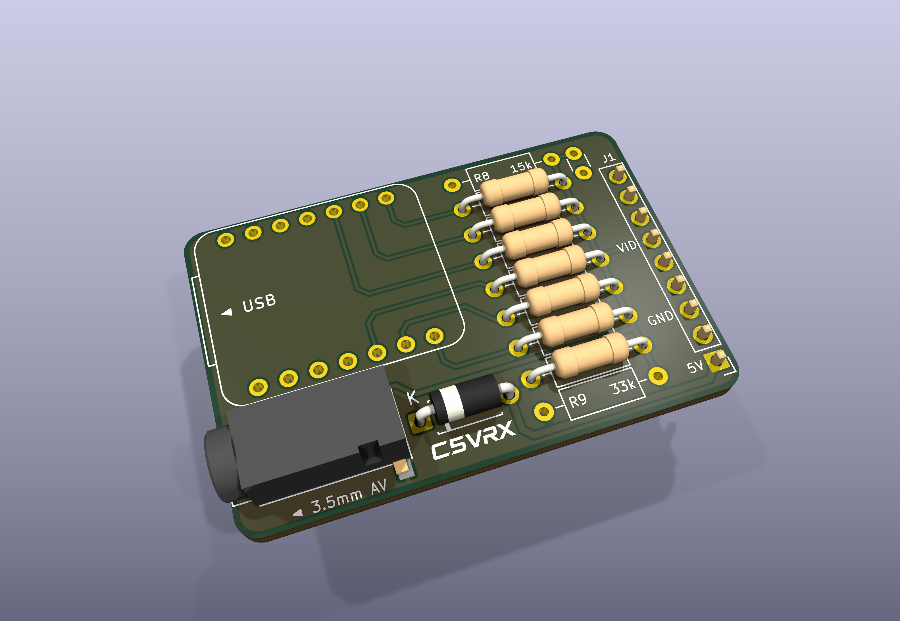
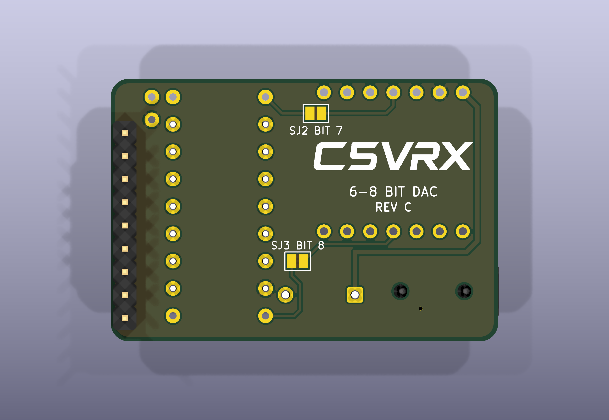

# C5VRX_JACK_DIY_V3 — REV C

A two-layer DIY carrier for the Seeed Studio XIAO ESP32-C5, with a Fat Shark module-bay header and PJ-320D 3.5 mm AV jack. REV C keeps the REV B outline (42.51 × 28.80 mm), part positions and DAC branches, and replaces the SJ1 bay-power solder bridge with a through-hole Schottky diode.

  
  

  
  
  

## Downloads

| File | Link |
| --- | --- |
| Gerber X2 + Excellon drills | [Fabrication ZIP](exports/C5VRX_JACK_DIY_V3-gerbers.zip) |
| KiCad 10 source | [Project](C5VRX_JACK_DIY_V3.kicad_pro) · [PCB](C5VRX_JACK_DIY_V3.kicad_pcb) · [Schematic](C5VRX_JACK_DIY_V3.kicad_sch) |
| Parts and assembly flags | [BOM](BOM.csv) |
| Schematic and fit check | [Schematic PDF](exports/C5VRX_JACK_DIY_V3-schematic.pdf) · [1:1 PDF](exports/C5VRX_JACK_DIY_V3-fit-check-1to1.pdf) |
| Mechanical models | [STEP](exports/C5VRX_JACK_DIY_V3.step) · [GLB](exports/C5VRX_JACK_DIY_V3.glb) |
| High-resolution images | [Front](exports/renders/01-front-perspective.png) · [Back](exports/renders/02-back-perspective.png) · [Low angle](exports/renders/05-front-low-angle.png) · [All five as ZIP](exports/C5VRX_JACK_DIY_V3-renders.zip) |

## Changes from REV B

- **D1 replaces SJ1.** A 1N5819 Schottky diode (1 A / 40 V, DO-41; a 1N5817 also fits) connects bay 5 V (anode) to XIAO 5 V (cathode). Bay power no longer needs a solder bridge, and there is no jumper to open before USB programming: the diode stops USB 5 V from feeding the goggle bay.
- D1 lies flat on the front, between the AV jack and R9, like the resistors. Fit it with the **band (cathode) toward the K mark**, on the jack side.
- D1 uses a project footprint (`C5VRX:D_DO-41_P7.62mm_Horizontal_Compact`): 7.62 mm lead pitch, 1.7 mm pads and 1.0 mm drills, so its courtyard fits between the jack and the resistor bank.
- To make room, bay 5 V now runs on the front along the bottom edge, the BIT 8 trace (SJ3 to R9) runs on the back underneath D1, between its pads, and one redundant GND via next to R7 was removed (R7's ground pad connects to both ground pours).
- The rear marking reads REV C, and the SJ1 label is gone.

The XIAO's 5 V rail is about 0.3 V lower on bay power (diode drop); the XIAO regulates its own 3.3 V from it. With USB and the bay connected at the same time, the higher of the two supplies feeds the XIAO.

## DAC branches and rear jumpers

| Jumper | Function | Default |
| --- | --- | --- |
| SJ2 / BIT 7 | Connect D10 / GPIO10 through R8 (15 kΩ) to VIDEO | Open |
| SJ3 / BIT 8 | Connect D3 / GPIO7 through R9 (33 kΩ) to VIDEO | Open |

R8 is **15 kΩ** and R9 is **33 kΩ**; R1–R7 and the 200 Ω load are unchanged. R8 and R9 are **DNP** with the current six-bit firmware. The jumpers only connect hardware branches; they do not select a firmware mode. These are new **low bits**: in a future seven-bit implementation D10 is bit 0; in an eight-bit implementation D10 is bit 1, D3 is bit 0, and the existing D4–D9 outputs are bits 2–7.

| Output configuration | SJ2 | SJ3 | Additional resistors |
| --- | --- | --- | --- |
| Current six-bit | Open | Open | R8/R9 DNP |
| Future seven-bit | Closed | Open | Fit R8 |
| Future eight-bit | Closed | Closed | Fit R8 and R9 |

Wider output requires matching firmware and loaded CVBS level/linearity measurements; it is not enabled or hardware-qualified by this PCB. D3/GPIO7 is a boot-strapping pin: validate repeated cold boots and reset loading before fitting/enabling R9. Keep the extra resistors unpopulated and jumpers open with current firmware.

R1–R7 retain the existing 8.2 kΩ / 3.9 kΩ / 2 kΩ / 1 kΩ / 470 Ω / 240 Ω branches and 200 Ω shunt. All resistors use DIN0207 axial through-hole footprints, 10.16 mm lead pitch; 1% is recommended. C1 is optional 470 pF / DNP. No additional 75 Ω shunt is fitted. J2 tip and ring 1 carry VIDEO, sleeve is GND, and ring 2 is unconnected.

## Files and checks

- Open `C5VRX_JACK_DIY_V3.kicad_pro` in **KiCad 10**. Project symbol/footprint libraries (including the D1 footprint) and the PJ-320D STEP model are included.
- [Fabrication ZIP](exports/C5VRX_JACK_DIY_V3-gerbers.zip): Gerber X2 plus plated/non-plated Excellon drills; [individual outputs](exports/gerbers/).
- [BOM](BOM.csv): PCB values, DNP flags and open rear solder bridges (PCB features, not purchased components).
- [Schematic PDF](exports/C5VRX_JACK_DIY_V3-schematic.pdf), [1:1 fit-check PDF](exports/C5VRX_JACK_DIY_V3-fit-check-1to1.pdf), top/bottom SVGs, STEP and GLB models are in `exports/`.
- [3200 × 2200 renders](exports/renders/) and [render ZIP](exports/C5VRX_JACK_DIY_V3-renders.zip). The XIAO mounting outline is visible because no module 3D model is supplied; DNP parts are omitted.
- [DRC report](validation/drc.json) and [ERC report](validation/erc.json): zero errors, zero unrouted connections and zero schematic/PCB parity issues. Generated with KiCad 10.0.7.

Digital checks are not physical qualification. REV C has not yet been built or measured. [REV B](../C5VRX_JACK_DIY_V2/) and [REV A](../C5VRX_JACK_DIY/) remain available.

## Source and attribution

This carrier adapts the existing `hardware/C5VRX_JACK_DIY` and `hardware/C5VRX_JACK_DIY_V2` (REV B) boards and DAC design from **C5VRX by Twotoz and the C5VRX contributors**. REV C replaces the SJ1 power jumper with the D1 Schottky diode and reroutes the affected 5 V and BIT 8 traces; the D1 footprint is derived from KiCad's `Diode_THT:D_DO-41_SOD81_P7.62mm_Horizontal` with smaller pads.

Canonical source: [Twotoz/C5VRX](https://github.com/Twotoz/C5VRX). Visit the [official C5VRX website](https://twotoz.github.io/C5VRX/) for the project and its Discord invite. Applicable source terms are in [LICENSE](../../LICENSE); separate name/logo terms remain in [BRANDING.md](../../assets/BRANDING.md). This proposed hardware revision is not a claim of an already released or physically validated product.
